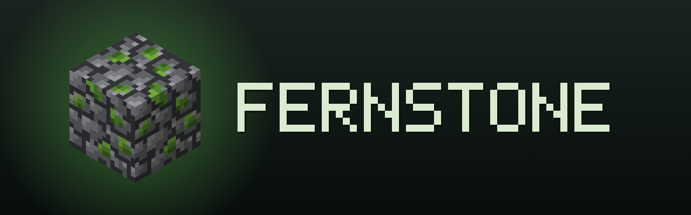
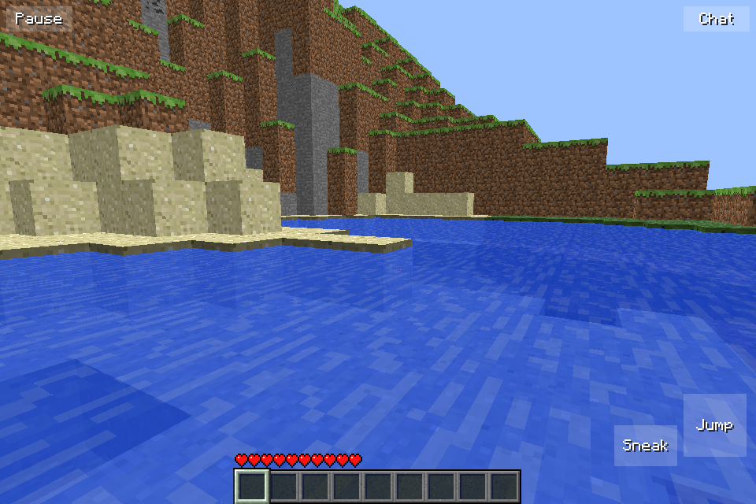
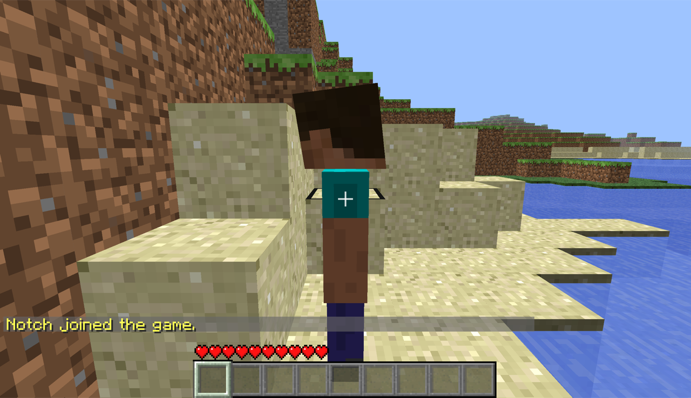
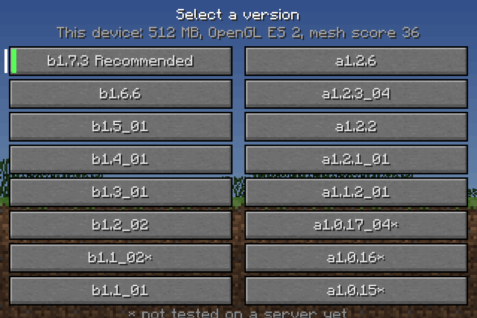
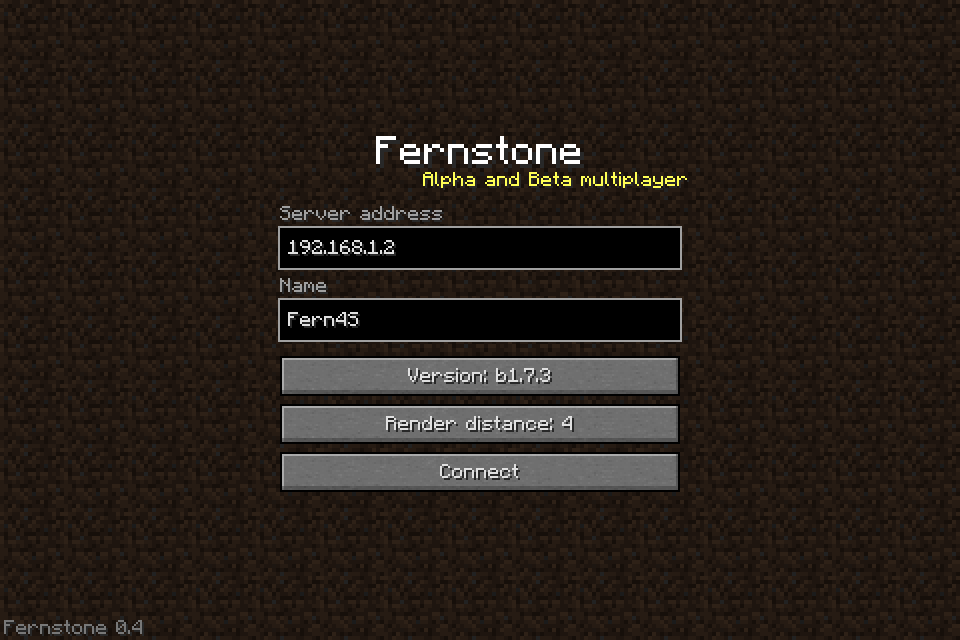
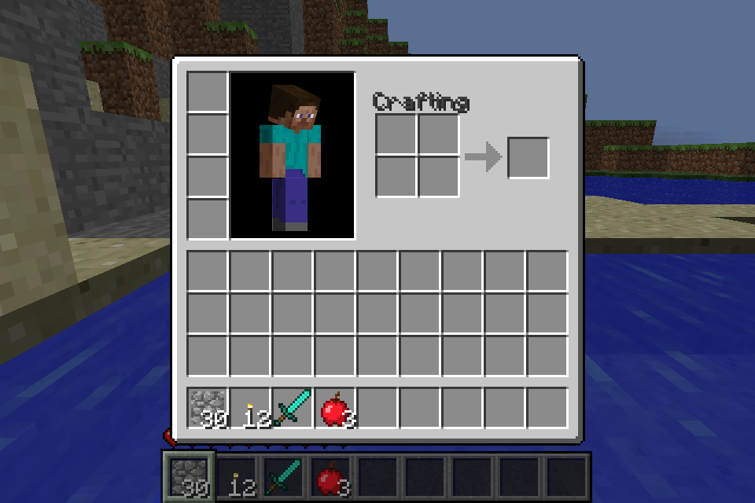
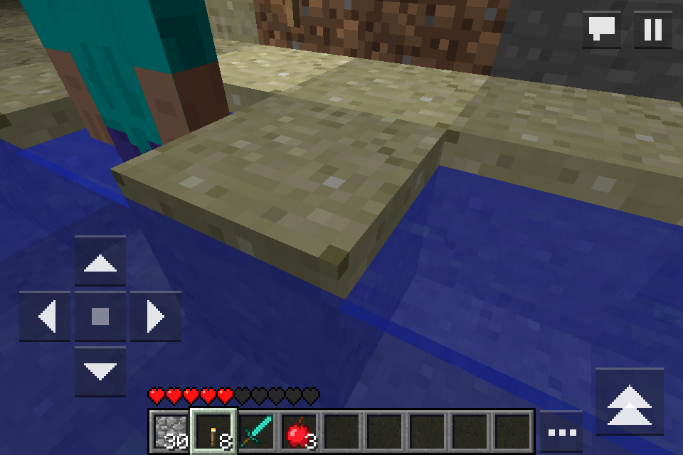

<div align="center">



### A native Minecraft client for Alpha and Beta multiplayer

_One C core and GLES2 for the iPhone 4S on iOS 6, the iPhone, and the Mac_


[](LICENSE)
[](https://github.com/Stiven-Gjekaj/fernstone/releases/latest)
[](https://ko-fi.com/stivengjekaj)

<p align="center">
  <a href="#overview"><b>Overview</b></a> |
  <a href="#you-need-a-client-jar"><b>Jar</b></a> |
  <a href="#install"><b>Install</b></a> |
  <a href="#play"><b>Play</b></a> |
  <a href="#build"><b>Build</b></a> |
  <a href="docs/decisions.md"><b>Decisions</b></a> |
  <a href="TODO.md"><b>Roadmap</b></a>
</p>

</div>

---

> [!NOTE]
> **Version 1.0.0 is out.** The iPhone 4S, the Mac, and the iOS 27
> simulator joined one Poseidon world at the same time and saw each other.
> Two clients saw the block changes of each other. The test of the iPhone
> 15 Pro Max in LiveContainer is still to do. [CHANGELOG.md](CHANGELOG.md) lists
> the changes of each release. [docs/decisions.md](docs/decisions.md) holds
> each decision and its reason.

> [!IMPORTANT]
> This is a fan project. It is not from Mojang or Microsoft. The repository
> and the packages hold no file of Minecraft. You need your own client jar.

---

<table>
<tr>
<td width="50%" valign="top">

<p align="center"><i>The iPhone 4S on iOS 6.1.3</i></p>
</td>
<td width="50%" valign="top">

<p align="center"><i>The Mac, with the player of the iPhone</i></p>
</td>
</tr>
<tr>
<td width="50%" valign="top">

<p align="center"><i>The version browser</i></p>
</td>
<td width="50%" valign="top">

<p align="center"><i>The title screen</i></p>
</td>
</tr>
<tr>
<td width="50%" valign="top">

<p align="center"><i>The inventory on the 4S</i></p>
</td>
<td width="50%" valign="top">

<p align="center"><i>Torch light at night on the 4S</i></p>
</td>
</tr>
</table>

## Overview

**Fernstone** joins Minecraft servers of Alpha and Beta, up to b1.7.3, for
example Project Poseidon in offline mode. Three devices can play in the same
world at the same time: an iPhone 4S with iOS 6, an iPhone with iOS 15 or
later (also in LiveContainer), and a Mac.

Java does not run well on the 4S, and LiveContainer has no JIT. Fernstone is
native code: one core in C99 with the protocol, the world, the physics, and
a GLES2 renderer, and a thin shell for each platform. The 4S uses its own
OpenGL ES 2.0. The iPhone and the Mac use ANGLE on Metal.

## Features

- The b1.7.3 protocol: the login, the chunks, the block changes, the
  entities, the chat, and the keep-alive
- The protocols of the older versions, from a1.0.15 to b1.6.6, in the same
  adapter
- The physics of Beta: the walk speed, the jump, the step up, the water,
  and the ladders
- Breaking with the dig time of Beta for each block and tool, and placing
- The other players with their skin, the mobs with the models and the
  textures of Beta, and the dropped items
- The hotbar, the hearts, the chat, and the inventory, chest, workbench,
  furnace, and dispenser screens
- The moving water and lava of Beta, and the light that spreads again
  after each block change
- The touch controls on the phones, and the keyboard and the mouse on the
  Mac
- A version browser that measures the device and tags the best version
- The meshing of the chunks on the second core, and one VBO for each chunk
  section

The 4S draws a frame in 16.4 ms at a render distance of 4 chunks.

## The versions

| Version | Status |
| ------- | ------ |
| b1.7.3 | Tested on Poseidon and Uberbukkit. Recommended on the 4S and the Mac. |
| b1.6.6, b1.5_01, b1.4_01, b1.3_01, b1.2_02, b1.1_01 | Tested on Uberbukkit |
| a1.2.6, a1.2.3_04, a1.2.2, a1.2.1_01, a1.1.2_01 | Tested on Uberbukkit |
| b1.1_02, a1.0.17_04, a1.0.16, a1.0.15 | Not tested |

[docs/protocol.md](docs/protocol.md) gives the differences of each
protocol.

## You need a client jar

The textures, the font, and the skins of Minecraft belong to Mojang.
Fernstone reads them from the client jar of the version that you play.

1. Get the client jar of the version from the launcher that you use. For
   b1.7.3 it is `versions/b1.7.3/b1.7.3.jar`, 1.4 MB, with
   `terrain.png` in its root.
2. Put it in the app:

| Device | How |
| ------ | --- |
| iPhone 4S, iOS 6 | Copy it to `/var/mobile/Media/Fernstone/jars/b1.7.3.jar` with an AFC tool or `scp`. |
| iPhone, iOS 15 or later | Tap **Import jar** in the menu and select the file. |
| Mac | Click **Import jar** in the menu and select the file. |

Each version uses its own jar, with the name of the version.

## Install

### iPhone 4S (iOS 6, jailbroken)

1. Download the `.deb` file from the
   [latest release](https://github.com/Stiven-Gjekaj/fernstone/releases/latest).
2. Copy it to the phone, for example with `scp` to `/tmp/`.
3. On the phone, as root: `dpkg -i /tmp/io.github.stivengjekaj.fernstone_*.deb`.

To remove the app: `dpkg -r io.github.stivengjekaj.fernstone`. On iOS 7 or
later, or with an APT that has TLS 1.2, you can also add the Cydia source
`https://stiven-gjekaj.github.io/cydia/`.

### iPhone (iOS 15 or later)

Add this source in SideStore or AltStore, and install Fernstone:

```
https://stiven-gjekaj.github.io/sidestore-source/apps.json
```

Or download `Fernstone.ipa` from the latest release and open it in SideStore
or LiveContainer. The app has no extension, no App Group, and no special
entitlement, so it runs in LiveContainer. If LiveContainer fails, install
the same .ipa with SideStore.

### Mac (macOS 12 or later, Apple silicon)

Download `Fernstone-macOS.zip` from the latest release, unzip it, and open
`Fernstone.app`.

## Play

1. Start a Beta server in offline mode, for example
   [Project Poseidon](https://github.com/retromcorg/Project-Poseidon).
   Beta has no LAN mode, so a server must run.
2. In Fernstone, tap **Join Server**. Type the IP address of the server,
   for example `192.168.1.20`, and your name. Use the IP address, not a
   name.
3. Tap **Join**.

On iOS 14 or later, iOS asks for the local network the first time. If the
connection fails and iOS did not ask, look at the Local Network setting of
the app first. In LiveContainer, the text of the prompt comes from the host
app.

The touch controls are those of Pocket Edition. A finger aims: the block
under the finger breaks or gets the new block.

| Action | Phone | Mac |
| ------ | ----- | --- |
| Walk | The D-pad at the bottom left | W A S D |
| Look | Drag on the world | The mouse |
| Break | Hold a finger on the block | The left button |
| Place | Tap the block | The right button |
| Jump | The button at the bottom right | Space |
| Sneak | The middle of the D-pad | Shift |
| Hotbar | Tap a slot | 1 to 9, the wheel |
| Chat | The speech button at the top right | T, or / for a command |
| Menu | The pause button at the top right | Escape |

## Build

You need a Mac with Xcode, `xcodegen`, `gh`, a JDK, and the iOS 9.3 SDK of
Theos.

1. Download `iPhoneOS9.3.sdk.tar.xz` from the releases of
   [theos/sdks](https://github.com/theos/sdks/releases) and unpack it into
   `sdks/`. Git does not track `sdks/`.
2. Run `./fix-sdk.sh` one time. It changes the SDK stubs for the new Apple
   linker and for iOS 6.
3. Run `scripts/angle.sh` one time. It builds MetalANGLE into `deps/`.
4. Build:

| Command | Result |
| ------- | ------ |
| `scripts/app.sh` | `build/ios6/Fernstone.app` for the 4S |
| `scripts/deb.sh` | The Cydia package in `build/` |
| `scripts/ios.sh --ipa` | `build/Fernstone.ipa`, not signed |
| `scripts/ios.sh --sim` | The app for the iOS simulator |
| `scripts/mac.sh` | `build/macos/Fernstone.app` |
| `scripts/cli.sh` | `build/fernstone-cli`, a client with no window |
| `scripts/test.sh` | The tests, on the Mac |
| `scripts/test.sh --phone` | The tests, on the 4S |
| `scripts/install.sh` | Builds the 4S app, copies it to the phone, and opens it |
| `scripts/tap.sh` | Sends debug commands to the app on the 4S |
| `scripts/shot.sh` | Saves a screenshot of the 4S |
| `scripts/server.sh` | Runs Poseidon on this Mac (`--uber` runs Uberbukkit) |
| `scripts/manifests.sh` | Puts `manifests/*.json` into the app |
| `scripts/icons.sh` | Draws the logo and the icons |
| `scripts/release.sh` | Tests, packs, tags, and publishes a release |

The phone scripts use `ssh iphone4s`. Set up that host in `~/.ssh/config`,
for example with a USB tunnel of `iproxy` on port 2222.

`build.sh` builds one armv7 binary. It compiles with ARC and links without
ARC, and all code is in ARM mode (`-marm`). The new Apple linker makes Thumb
code that crashes on iOS 6 before `main` starts.

`build/fernstone-cli` joins a server with no window and runs a script of
commands:

```
build/fernstone-cli 192.168.1.20 Steve --version b1.7.3 --script walk.txt
```

## Support

If you find Fernstone useful, you can support its development here.

[](https://ko-fi.com/stivengjekaj)

## Licence

The code is under the MIT licence. See [LICENSE](LICENSE). The iPhone and
Mac apps link MetalANGLE under the BSD licence of ANGLE, as
[licenses/ANGLE.txt](licenses/ANGLE.txt) tells. Minecraft and its textures,
font, and skins belong to Mojang.
